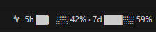

# Usage Meter for Claude Code

A VS Code status-bar item that shows your Claude Code plan-limit percentages
(5-hour session and 7-day week) and locally measured token counts, always visible,
without opening a panel or running `/usage`.

This is an independent project. It is not affiliated with, sponsored by or endorsed by Anthropic.
"Claude" and "Claude Code" are trademarks of Anthropic.

```
$(pulse) 5h 42% ▰▰▱▱▱ · 7d 59% ▰▰▰▱▱
```


The status bar item (layout shown is from an earlier version; the current version prints the percentage first, then a thin gauge).

- Status bar: the 5-hour and 7-day percentages, with a small gauge per window.
  Amber at 70 %, red at 90 %. A `~` means the numbers are older than they should be.
  A `!` means the last fetch failed.
- Hover: reset countdowns and measured token counts.
- Click (or run **Claude Usage: Show Details**): a panel with per-day and per-project
  token charts and a burn-rate estimate.

## How the percentages are obtained

This is the part you should read before installing.

- The extension reads your **Claude Code OAuth access token locally** from
  `~/.claude/.credentials.json` (the `claudeAiOauth.accessToken` field). It never
  refreshes the token. If the token is missing or expires within 60 seconds, it is not used.
- It calls **one endpoint**: `GET https://api.anthropic.com/api/oauth/usage`, with the header
  `Authorization: Bearer <token>`, every `claudeUsage.pollSeconds` (default 120 s, minimum 30 s).
  Requests from all VS Code windows on the machine share one cache, so the rate is per machine.
- **This endpoint is not officially documented.** It is the same one Claude Code's `/usage`
  command uses, but Anthropic may change, rename or remove it without notice, and this
  extension may then stop working. When it fails, the extension falls back to the copy
  Claude Code keeps in `~/.claude.json` (`cachedUsageUtilization`), which only refreshes
  while a Claude Code session is running.
- **No data is sent anywhere else.** The extension makes no other network calls: no
  telemetry, no analytics, no crash reporting, no update checks. The only outbound request is
  the one above. Token counts are computed from your local transcripts under `~/.claude/projects`
  and never leave the machine.
- Claude Code's statusline input also exposes rate-limit fields (see the official statusline documentation) which may be a documented alternative; this extension currently uses the usage endpoint.

### Local files this extension writes

All under `~/.claude/`. None contain the OAuth token.

| File | Contents |
| --- | --- |
| `usage-util-cache.json` (and `.lock`) | Last successful endpoint response, fetch timestamps, failure/backoff state, short history of percentages for burn-rate estimates. |
| `usage-cache-vscode-<pid>.json` | Per-file byte offsets and per-request token totals aggregated from transcripts. Stale copies are deleted after 3 days. |
| `usage-render-beacon-<pid>.json` | Renderer version and time of the last render, so the version in use can be checked. |

## Token counts vs percentages

They are two different measurements and do not track each other linearly.

- **Percentages**: server-side plan limits. Accurate, but only as fresh as the last successful fetch.
- **Token counts**: aggregated locally from transcripts. Always current. Input + cache write +
  cache read + output, so cache reads dominate the total.

## Install

Requires VS Code 1.85 or newer, Node.js (for building), and Claude Code signed in on this machine.

The `publisher` field in `package.json` is a placeholder (`<PUBLISHER-ID>`) until a Visual Studio
Marketplace publisher exists. Set it to that publisher's ID, then build the VSIX from source:

```
npm install -g @vscode/vsce
node preflight.js
vsce package
code --install-extension claude-code-usage-meter-0.0.28.vsix
```

`vsce package` will refuse to run while the placeholder is still in place.

Then reload the VS Code window. Set `claudeUsage.alignment` and reload again if you want the item on the left.

`preflight.js` is the build gate: it checks the bundled core, the renderer exports, the
rendered panel layout and the status-bar text helpers. Run it before every package.

## Settings

| Setting | Default | Meaning |
| --- | --- | --- |
| `claudeUsage.refreshSeconds` | 15 | How often to re-aggregate transcripts (minimum 5). |
| `claudeUsage.pollSeconds` | 120 | How often to re-fetch the plan-limit percentages from the endpoint above (minimum 30). |
| `claudeUsage.windowDays` | 7 | Rolling window in days for the week token figure (1 to 8; rows older than 8 days are pruned). |
| `claudeUsage.sessionWindowHours` | 5 | Length of the rolling session token window, in hours (1 to 192). |
| `claudeUsage.weekTokenBudget` | 0 | Fallback denominator for the week bar when no cached `/usage` data exists. 0 = off. |
| `claudeUsage.sessionTokenBudget` | 0 | Fallback denominator for the session bar when no cached `/usage` data exists. 0 = off. |
| `claudeUsage.showBars` | true | Draw a block gauge next to each percentage. |
| `claudeUsage.barWidth` | 5 | Number of cells in each gauge (3 to 20). |
| `claudeUsage.alignment` | right | Status-bar side (reload the window after changing). |

## Commands

- **Claude Usage: Show Details**: the per-day and per-project panel.
- **Claude Usage: Refresh Now**: fetch and re-aggregate immediately.
- **Claude Usage: Calibrate Budget From /usage**: derives a token budget from the percentage
  `/usage` shows. Only needed for the fallback path when no cached percentages exist.

## Limits of this extension

- The percentage path depends on an undocumented endpoint and may stop working without warning.
- Calibration and budgets only matter when the percentages are unavailable.
- `deploy-live.js` and `verify-live.js` are developer scripts for Windows workstations
  (PowerShell and `Code.exe` process inspection). They are excluded from the VSIX.

## Development

- `usage-core.cjs` is shared with Claude Code's own statusline tooling. Keep it byte-identical
  wherever it is installed.
- `panel-render.js` must not require the `vscode` module, because the preflight re-requires it outside VS Code.

## Security

See [SECURITY.md](SECURITY.md).

## License

MIT. See [LICENSE](LICENSE).
